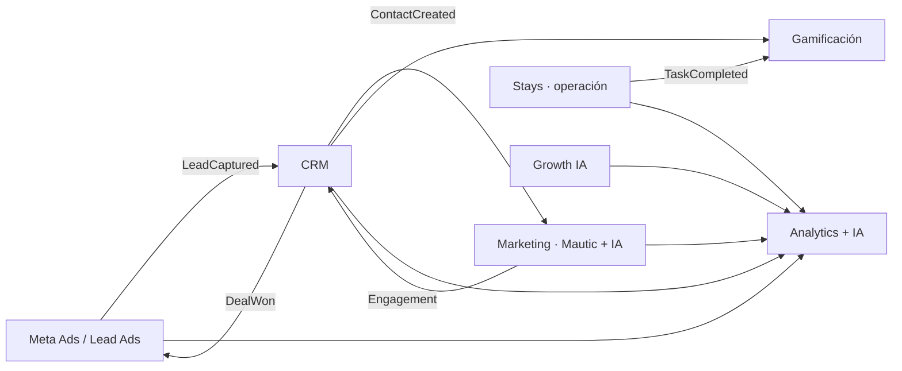

# 1heavy — Growth & Operations OS

**1heavy** es la plataforma unificada que nace de fusionar **MerakiOS** (motor de estrategia de
crecimiento con IA) y **1heavy Stays** (operación de alquileres de corta estadía por WhatsApp).
Un solo producto multi-tenant para que un negocio **capte, convierta, opere y retenga**:

| Módulo | Qué resuelve | Origen |
|---|---|---|
| **Identity** | Workspaces multi-tenant, roles (RBAC), marca blanca | Stays + MerakiOS |
| **Stays** | Propiedades, personal, limpiezas con evidencia fotográfica, escalamiento, cortes de servicios, iCal | 1heavy Stays |
| **CRM** | Contactos, ciclo de vida, pipeline de negocios, timeline, lead scoring con IA | Nuevo |
| **Marketing (Mautic + IA)** | Segmentos, emails y campañas generados por IA y ejecutados en Mautic | Nuevo |
| **Meta Business** | Insights de Ads, Lead Ads → CRM, alertas de rendimiento, Conversions API | MerakiOS (Director) |
| **Growth IA** | Auditoría de mercado, arquitecto de embudos, generación de assets | MerakiOS (Genesis/Blueprint) |
| **Gamificación** | Puntos, niveles, insignias, retos y leaderboards a partir de eventos reales | Nuevo |
| **Analytics** | KPIs operativos, comerciales y de marketing + insights IA | Stays + nuevo |
| **Billing** | Planes y suscripciones con Wompi | 1heavy Stays |



## Inicio rápido

Requisitos: Python 3.12, Node 22, Docker.

```bash
make setup      # venv + dependencias API, npm ci, pre-commit, archivos .env
make up         # stack completo en Docker: web :8088 · api :8000 · mautic :8081 · evolution :8080
# — o desarrollo con recarga en caliente —
make up-deps    # sólo Postgres, Redis, Mautic, Evolution
make dev-api    # http://localhost:8000/docs
make dev-web    # http://localhost:5173
make ci         # lint + typecheck + tests + build (igual que GitHub Actions)
```

Sin Docker, la API corre con SQLite: `ONEHEAVY_DATABASE_URL=sqlite+aiosqlite:///./oneheavy_local.db`.
Por defecto la IA (`fake`) y WhatsApp (`console`) usan dobles locales; ver `apps/api/.env.example`.

## Estructura

```
apps/
  api/            FastAPI · monolito modular hexagonal (src/oneheavy/{shared,modules/*})
  web/            React 18 + Vite + Tailwind + shadcn/ui
infra/            docker-compose (Postgres+pgvector, Redis, Mautic, Evolution API)
docs/
  architecture/   visión general C4, módulos, eventos, OOP, ADRs, contrato REST
  product/        análisis de producto, casos de uso, actores
  process/        flujo de desarrollo, pipelines, testing, seguridad
  design/         design system y paleta
.github/          CI, CodeQL, Dependabot, plantillas de PR e issues
```

## Documentación

- Arquitectura: [visión general](docs/architecture/overview.md) · [módulos](docs/architecture/modules.md) · [eventos](docs/architecture/events.md) · [diseño OO](docs/architecture/oop-design.md) · [contrato REST](docs/architecture/api-contract.md) · [ADRs](docs/architecture/adr/)
- Producto: [análisis](docs/product/analisis-producto.md) · [casos de uso](docs/product/casos-de-uso.md) · [actores](docs/product/mapa-de-actores.md)
- Proceso: [flujo de desarrollo](docs/process/flujo-de-desarrollo.md) · [pipelines](docs/process/pipelines.md) · [testing](docs/process/testing.md) · [seguridad](docs/process/seguridad.md)
- Diseño: [design system](docs/design/design-system.md)
- Contribuir: [CONTRIBUTING.md](CONTRIBUTING.md) · [CHANGELOG.md](CHANGELOG.md)
