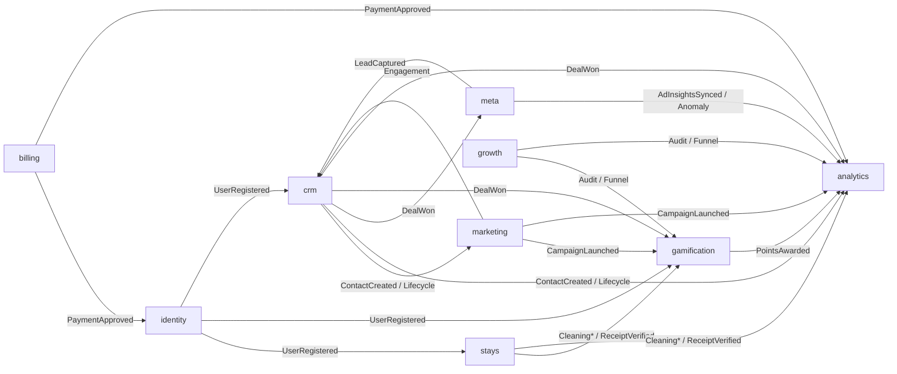

# Bounded contexts

Resumen por módulo. Endpoints exactos en el [contrato REST](api-contract.md); eventos en [events.md](events.md).

## identity — Identidad, workspaces y marca blanca
- **Responsabilidad:** registro self-service, login, sesión, miembros y roles, branding por workspace.
- **Agregados:** `Workspace` (plan, `Branding`, `whatsapp_instance`, plantillas de mensajes), `User` (rol, email/teléfono como VO).
- **Puertos:** `WorkspaceRepository`, `UserRepository`, `IdentityUnitOfWork`, `PasswordHasherPort`, `TokenIssuer`, `MessageSender`.
- **Adaptadores:** SQLAlchemy, bcrypt, PyJWT, WhatsApp (bienvenida sin contraseña).
- **Emite:** `WorkspaceCreated`, `UserRegistered`. **Consume:** `PaymentApproved` (cambio de plan).

## stays — Operación de alquileres de corta estadía (ex 1heavy Stays)
- **Responsabilidad:** propiedades, personal, tareas de limpieza con evidencia, checklist, incidencias, escalamiento, cortes de servicios y comprobantes, sincronización iCal, dashboard operativo.
- **Agregados:** `Property` (cortes de facturación, checklist, inventario visual, iCal, automatización pausada), `CleaningTask` (máquina de estados `pending → arrived → in_progress → completed | cancelled`), `Receipt` (`pending → verified | rejected`), `StaffMember` (vista propia del personal, alimentada por `UserRegistered` con rol staff), `StaysSettings` por workspace.
- **Puertos:** repositorios por agregado, `StaysUnitOfWork`, `ReservationCalendar` (iCal), `MessageSender`, `FileStorage`.
- **Jobs:** recordatorio diario, confirmación de llegada + escalamiento (cada 5 min), cortes de servicios (09:00), sync iCal.
- **Emite:** `CleaningTaskScheduled`, `CleaningArrivalConfirmed`, `CleaningIssueReported`, `CleaningTaskCompleted`, `ReceiptVerified`. **Consume:** `UserRegistered`.

## crm — Contactos, pipeline y lead scoring
- **Responsabilidad:** fuente única de verdad de personas y oportunidades; deduplicación; ciclo de vida; timeline; scoring explicable.
- **Agregados:** `Contact` (ciclo de vida `subscriber → lead → mql → sql → opportunity → customer → evangelist | lost`, score 0–100, tags), `Deal` (`new → qualified → proposal → negotiation → won | lost`), `Activity`.
- **Estrategias:** `LeadScoringStrategy` (reglas de perfil + engagement + recencia) con explicación IA vía `LLMClient`.
- **Emite:** `ContactCreated`, `ContactLifecycleChanged`, `DealWon`, `DealLost`. **Consume:** `LeadCaptured`, `MarketingEngagementRecorded`, `UserRegistered` (opcional: dueños de contactos).

## marketing — Mautic + IA
- **Responsabilidad:** segmentación, generación de emails y planes de campaña con IA, sincronización con Mautic, recepción de engagement.
- **Agregados:** `Segment` (filtros sobre etapa/tags/score), `EmailDraft` (`draft → pushed → sent`), `Campaign` (`planned → active → paused → completed`, pasos por día/canal).
- **Puertos:** `MauticGateway` (contactos, segmentos, emails, campañas) con `HttpMauticGateway` (REST API de Mautic) y `InMemoryMauticGateway`; `LLMClient`.
- **Emite:** `CampaignLaunched`, `MarketingEngagementRecorded`. **Consume:** `ContactCreated`, `ContactLifecycleChanged`.

## meta — Meta Business
- **Responsabilidad:** conexión a la cuenta publicitaria, insights de campañas, Lead Ads → CRM, alertas de rendimiento (ex *Director* de MerakiOS), Conversions API.
- **Agregados:** `MetaConnection` (cuenta, página, pixel, token opaco), `CampaignSnapshot`, `DailyInsight`, `PerformanceAlert`.
- **Estrategias:** reglas de anomalía (CTR bajo, CPL alto, frecuencia alta…) como `AnomalyRule`.
- **Puertos:** `MetaGraphGateway` (HTTP Graph API / fake), `ConversionsApi`.
- **Emite:** `LeadCaptured`, `AdInsightsSynced`, `AdPerformanceAnomalyDetected`. **Consume:** `DealWon`, `ContactLifecycleChanged` (eventos de conversión).

## growth — Motor de estrategia IA (ex MerakiOS)
- **Responsabilidad:** auditoría de mercado, diseño de embudos y generación de assets para un nicho.
- **Agregados:** `GrowthProject` (`draft → analyzing → audited → designing → completed | failed`), `MarketAudit` (VO: avatar, dolores, deseos, nivel de consciencia de Schwartz, JTBD), `FunnelBlueprint` (VO: nodos y aristas compatibles con React Flow).
- **Pipelines:** `GenesisPipeline` (Planner → Researcher → Auditor, hasta 2 iteraciones), `BlueprintPipeline` (Architect → Validator), `AssetGenerator`. Cada paso es una clase `PipelineStep`.
- **Puertos:** `LLMClient`, `WebSearch`.
- **Emite:** `MarketAuditCompleted`, `FunnelDesigned`.

## gamification — Motivación basada en resultados reales
- **Responsabilidad:** convertir eventos de negocio en puntos, niveles, rachas, insignias, retos y rankings por equipo.
- **Agregados:** `PlayerProfile`, `PointTransaction` (ledger inmutable, idempotente por `event_id + rule_key`), `PointRule` (configurable por workspace), `Badge`, `Challenge`.
- **Estrategias:** una regla por tipo de evento (p. ej. limpieza a tiempo, fotos completas, negocio ganado, campaña lanzada, auditoría completada).
- **Emite:** `PointsAwarded`. **Consume:** `UserRegistered`, `CleaningArrivalConfirmed`, `CleaningTaskCompleted`, `ReceiptVerified`, `ContactCreated`, `DealWon`, `CampaignLaunched`, `MarketAuditCompleted`, `FunnelDesigned`.

## analytics — Analítica unificada
- **Responsabilidad:** KPIs cruzados sin acoplarse a otros módulos: proyecta eventos en una tabla de hechos propia (`analytics_facts`) y calcula overview, series y embudo; genera insights con IA.
- **Consume:** prácticamente todos los eventos de integración. **Emite:** ninguno.

## billing — Suscripciones
- **Responsabilidad:** catálogo de planes, checkout Wompi (firma de integridad), webhook con checksum, estado de suscripción.
- **Agregados:** `Subscription` (`trialing → active → past_due → canceled`), `Payment`.
- **Puertos:** `PaymentGateway` (Wompi).
- **Emite:** `PaymentApproved`.

## Mapa de dependencias por eventos

