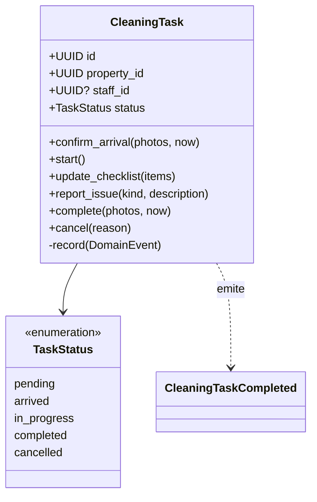

# Diseño orientado a objetos

1heavy aplica DDD táctico y patrones GoF/PoEAA donde resuelven un problema concreto, no por decoración.

## Bloques de dominio
| Concepto | Clase base / ejemplo | Regla |
|---|---|---|
| **Entity** | `shared.domain.entity.Entity` | identidad por `id`; `touch()` actualiza `updated_at` |
| **Aggregate Root** | `AggregateRoot` → `Workspace`, `User`, `CleaningTask`, `Contact`, `Deal`, `GrowthProject`, `PlayerProfile` | única puerta de modificación; registra eventos con `record()` |
| **Value Object** | `Email`, `PhoneNumber` (E.164), `Money`, `Branding`, `MarketAudit`, `FunnelBlueprint` | inmutable (`frozen`), se auto-valida en `__post_init__` |
| **Domain Event** | `DomainEvent` + `integration_events` | hecho inmutable, publicado tras commit |
| **Domain Error** | `BusinessRuleViolation`, `NotFoundError`, `PermissionDenied`… | el adaptador HTTP traduce a códigos de estado |
| **Policy** | `assert_can_assign_role`, `Principal.require` | reglas de autorización expresadas en el dominio |

## Patrones y dónde se usan

| Patrón | Dónde | Por qué |
|---|---|---|
| **Repository** | `*Repository` (ABC en `domain/`), `Sql*Repository` en `infrastructure/` | aislar la persistencia; mapeo explícito fila ↔ entidad |
| **Unit of Work** | `UnitOfWork`, `SqlAlchemyUnitOfWork`, `SqlIdentityUnitOfWork`… | un caso de uso = una transacción; publica eventos sólo si confirma |
| **Command** | `RegisterWorkspaceCommand`, `InviteMemberCommand`… + `UseCase[In, Out]` | intención explícita, inmutable, fácil de probar |
| **Strategy** | lead scoring (crm), reglas de puntos (gamification), reglas de anomalía (meta), modo de fotos estándar/aleatorio (stays), proveedor LLM | variar el algoritmo sin tocar al cliente |
| **Pipeline / Chain of Responsibility** | `GenesisPipeline` (Planner → Researcher → Auditor con bucle), `BlueprintPipeline` (Architect → Validator) | pasos pequeños, sustituibles y testeables por separado |
| **State** | `CleaningTask`, `Contact.stage`, `Deal.stage`, `GrowthProject.status`, `Subscription.status`, `Receipt.status` | transiciones válidas centralizadas; las inválidas lanzan `BusinessRuleViolation` |
| **Adapter** | `EvolutionApiSender`, `OpenAIChatClient`, `TavilyWebSearch`, `HttpMauticGateway`, `HttpMetaGraphGateway`, Wompi, lector iCal | traducir APIs externas a puertos del dominio |
| **Null Object / Fake** | `NullWebSearch`, `FakeLLMClient`, `ConsoleMessageSender`, gateways en memoria | desarrollo sin credenciales y tests deterministas |
| **Observer (Pub/Sub)** | `EventBus` / `InMemoryEventBus` | desacoplar módulos: gamificación reacciona a una limpieza sin que Stays la conozca |
| **Factory / Composition Root** | `Container.from_settings()`, `create_app()`, factories `Workspace.create`, `User.register` | creación en un solo lugar; invariantes desde el nacimiento |
| **Template Method** | `LLMClient.complete_json()` (usa `complete()` de cada subclase); `Module` (hooks `router/register/jobs`) | algoritmo común, pasos variables |
| **Projection (CQRS ligero)** | analytics: tabla de hechos alimentada por eventos | lecturas analíticas sin acoplar escrituras |
| **Mapper** | `_user_to_domain` / `_user_apply` en persistencia | el dominio no conoce el ORM |

## Ejemplo: máquina de estados de una tarea

## SOLID en el código
| Principio | Aplicación |
|---|---|
| **S** — Responsabilidad única | un caso de uso por clase; routers sólo traducen HTTP ↔ comandos |
| **O** — Abierto/cerrado | nuevas reglas de puntos o anomalías = nueva clase Strategy registrada; nuevos módulos = nueva implementación de `Module` |
| **L** — Sustitución de Liskov | cualquier `LLMClient`/`MessageSender`/gateway puede reemplazar a otro (los fakes pasan las mismas pruebas) |
| **I** — Segregación de interfaces | puertos pequeños (`WebSearch.search`, `FileStorage.save`); UoW por módulo con sólo sus repositorios |
| **D** — Inversión de dependencias | casos de uso dependen de ABC/Protocol; implementaciones inyectadas por el Container |
