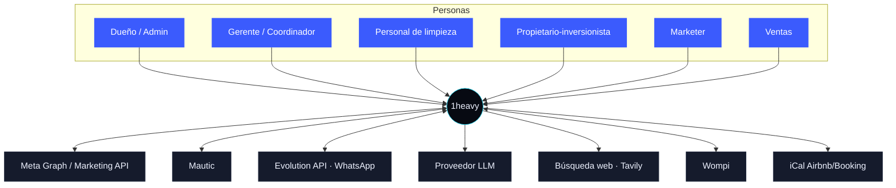
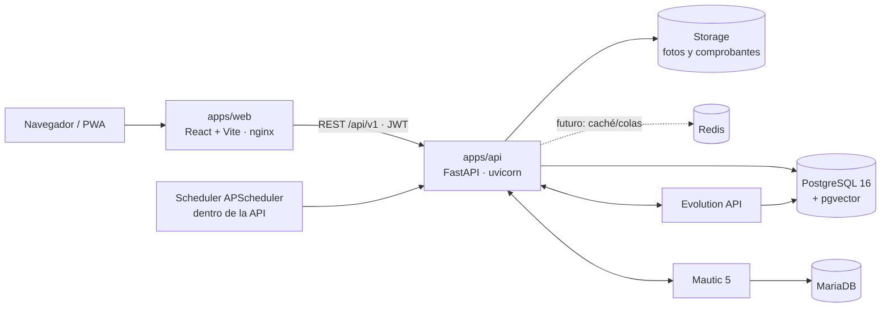
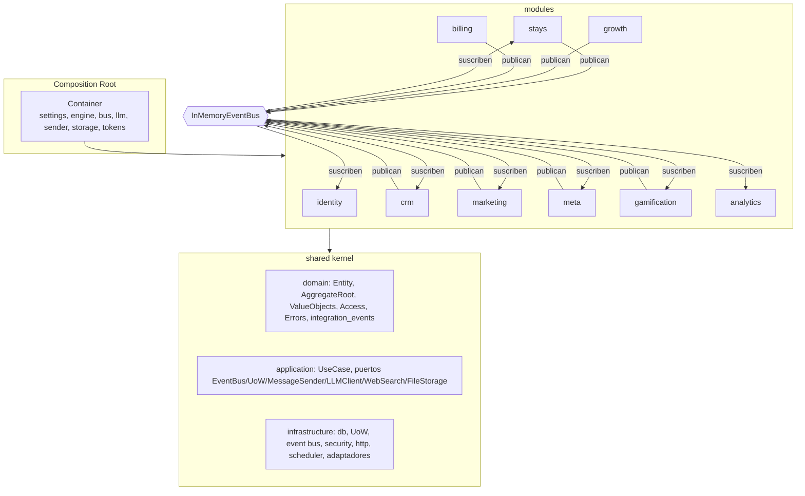
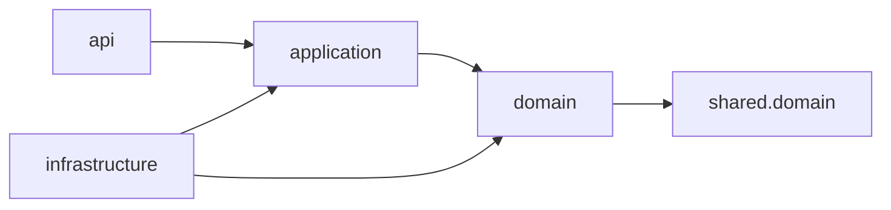
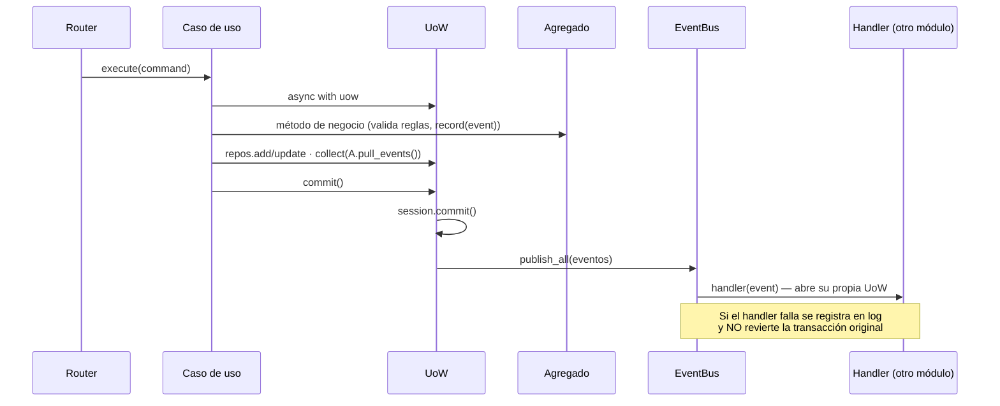

# Arquitectura de 1heavy — visión general

**Estilo:** monolito modular (un despliegue) organizado por *bounded contexts*, cada uno con
**arquitectura hexagonal** (puertos y adaptadores). Los módulos se comunican por **eventos de
integración** en proceso. Decisiones en [ADRs](adr/).

## C4 · Nivel 1 — Contexto



## C4 · Nivel 2 — Contenedores



## C4 · Nivel 3 — Componentes de la API



## Capas hexagonales de cada módulo

```
modules/<contexto>/
  domain/          Entidades, agregados, value objects, reglas, repositorios (ABC). Python puro.
  application/     Casos de uso (Command → resultado), UoW del módulo (ABC), puertos externos.
  infrastructure/  ORM SQLAlchemy, repositorios SQL, adaptadores HTTP (Mautic, Meta, Wompi...), fakes.
  api/             Router FastAPI + esquemas Pydantic (adaptador de entrada).
  __init__.py      <Contexto>Module: router(), register(container), jobs(container)
```

**Regla de dependencia:** `api → application → domain` e `infrastructure → application/domain`.
El dominio no depende de nada externo. **Ningún módulo importa a otro**; sólo comparten `shared/`
y el catálogo `shared/domain/integration_events.py` (*Published Language*).



## Contrato de módulo y Composition Root
`Container.from_settings()` es el único lugar que elige implementaciones concretas (p. ej. `FakeLLMClient`
vs `OpenAIChatClient`, `ConsoleMessageSender` vs `EvolutionApiSender`) según configuración. Cada módulo
implementa `Module`:

| Hook | Uso |
|---|---|
| `router()` | expone su API bajo `/api/v1` |
| `register(container)` | suscribe handlers al bus y registra singletons propios en `container.extras` |
| `jobs(container)` | procesos batch (`ScheduledJob`) que el `Scheduler` agenda al arrancar |

`create_app()` recorre `default_modules()`; los tests inyectan un `Container` con SQLite y fakes.

## Unit of Work y eventos después del commit



## Multi-tenancy
- Esquema compartido: toda tabla de negocio tiene `tenant_id` indexado ([ADR-0006](adr/0006-multi-tenant-esquema-compartido.md)).
- El `tenant_id` sale del JWT (`Principal`), nunca del cliente. Los repositorios reciben el tenant explícitamente.
- Cada workspace tiene su marca blanca y su propia instancia de WhatsApp (`whatsapp_instance`).

## Atributos de calidad
| Atributo | Táctica |
|---|---|
| Mantenibilidad | módulos aislados, contrato REST, eventos tipados, mypy estricto |
| Testabilidad | puertos con fakes, Composition Root inyectable, SQLite en memoria |
| Seguridad | RBAC, tenant por token, firmas de webhooks, validación de uploads ([seguridad](../process/seguridad.md)) |
| Resiliencia | handlers aislados, errores externos → 502 controlado, jobs con `coalesce` |
| Escalabilidad | API stateless; bus y rate limiter reemplazables por Redis; módulo extraíble a servicio si lo exige la carga |
| Observabilidad | logs JSON estructurados, `/health`, eventos auditables |
