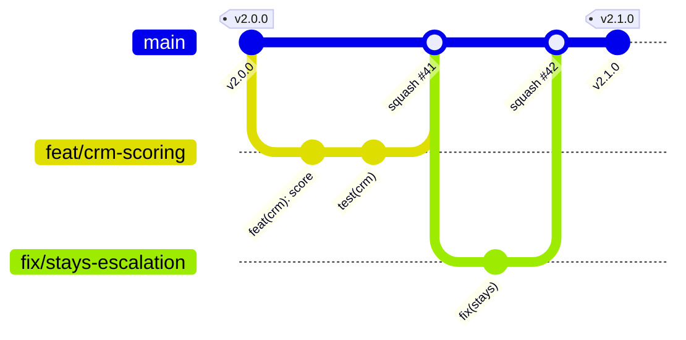

# Flujo de desarrollo

## 1. Modelo de ramas: trunk-based con ramas cortas

- `main` siempre desplegable; protegida (PR obligatorio, CI verde, 1 aprobación, historia lineal).
- Ramas: `feat/<modulo>-<tema>`, `fix/…`, `refactor/…`, `chore/…`, `docs/…`. Vida máxima: **3 días**.
- Integración por **squash merge**; el título del PR es el mensaje del commit.
- Trabajo grande → se divide por caso de uso o se oculta tras *feature flag*.

## 2. Conventional Commits

`tipo(alcance): resumen en imperativo` · tipos: `feat fix refactor perf test docs chore ci build`.
Alcances: `identity stays crm marketing meta growth gamification analytics billing shared web infra`.
`feat!:` o footer `BREAKING CHANGE:` ⇒ versión mayor.

## 3. Tamaño del PR
| Líneas efectivas (sin lockfiles ni snapshots) | Acción |
|---|---|
| ≤ 200 | ideal |
| 201–400 | aceptable, describir bien |
| > 400 | dividir (salvo migraciones mecánicas acordadas) |

## 4. Checklist de code review
**Diseño:** ¿el caso de uso vive en `application/` y la regla en `domain/`? ¿Respeta la regla de dependencia (ningún import entre módulos)? ¿Los nombres hablan el lenguaje del negocio?
**Corrección:** ¿filtra por `tenant_id`? ¿valida permisos con `Principal.require`? ¿maneja estados inválidos con `BusinessRuleViolation`? ¿fechas UTC aware?
**Eventos:** ¿se publican sólo tras `commit()`? ¿los handlers son idempotentes y abren su propia UoW?
**Pruebas:** dominio (unitario) + endpoint (integración) incluyendo error, permisos y aislamiento de tenant.
**Seguridad:** sin secretos, validación de entrada con Pydantic, webhooks con firma, sin datos personales en logs.
**Rendimiento:** sin N+1, índices en columnas de filtro, paginación en listados.
**Frontend:** estados de carga/vacío/error, accesible con teclado, sin colores fuera de tokens.

## 5. Definition of Ready (DoR)
- Caso de uso con ID, actor, flujo y reglas (`docs/product/casos-de-uso.md`).
- Criterios de aceptación verificables (Dado / Cuando / Entonces).
- Impacto en contrato REST y eventos identificado.
- Dependencias externas (Meta, Mautic, Wompi) con credenciales de sandbox disponibles.
- Estimado ≤ 3 días.

## 6. Definition of Done (DoD)
- Código + pruebas en verde en CI (`ruff`, `mypy`, `pytest` ≥ 80 % cobertura, `eslint`, `tsc`, build).
- Contrato, eventos, `.env.example` y CHANGELOG actualizados si aplica.
- Revisado y aprobado; desplegado en staging y verificado con smoke test.
- Métrica/log que permita observar el caso de uso en producción.

## 7. Versionado y releases
- **SemVer** sobre la plataforma completa (`apps/api` y `apps/web` comparten versión).
- Release: mover *Unreleased* del CHANGELOG a `## [x.y.z] — fecha`, tag `vX.Y.Z` en `main`.
- `fix` ⇒ patch · `feat` ⇒ minor · breaking ⇒ major.

## 8. Ambientes
| Ambiente | Origen | Datos | Integraciones | Propósito |
|---|---|---|---|---|
| local | rama | SQLite / Postgres Docker | fakes (`llm=fake`, `messaging=console`) | desarrollo |
| staging | cada merge a `main` | Postgres gestionado, datos sintéticos | sandbox Meta, Mautic staging, Wompi pruebas | QA y demo |
| production | tag `vX.Y.Z` aprobado | Postgres gestionado con backups PITR | reales | clientes |

## 9. Feature flags
Las capacidades con integraciones externas se activan por configuración (`ONEHEAVY_MAUTIC_ENABLED`,
`ONEHEAVY_META_ENABLED`, `ONEHEAVY_LLM_PROVIDER`, `ONEHEAVY_MESSAGING_PROVIDER`). Las funciones de producto
por plan se resuelven en el dominio (plan del workspace). Un flag se elimina como máximo dos releases después de quedar al 100 %.

## 10. Despliegue y rollback
1. CI verde en `main` → build de imágenes etiquetadas con el SHA.
2. Deploy automático a staging → smoke test (`/health`, login, crear contacto, crear tarea).
3. Promoción manual a producción con el mismo SHA (las imágenes son inmutables).
4. **Rollback**: redeploy del SHA anterior. Las migraciones deben ser *expand/contract* (compatibles hacia atrás durante una versión) para permitir rollback sin restaurar la base.
