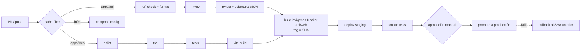
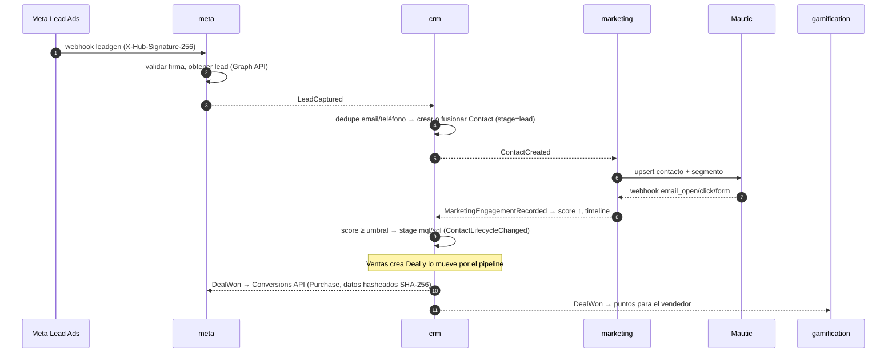
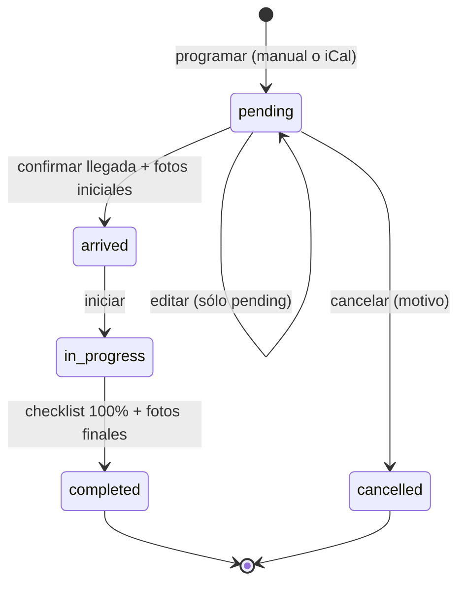
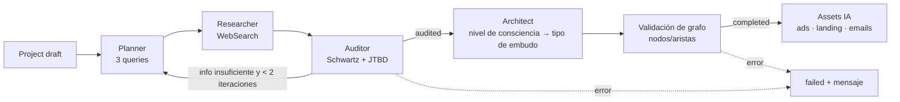
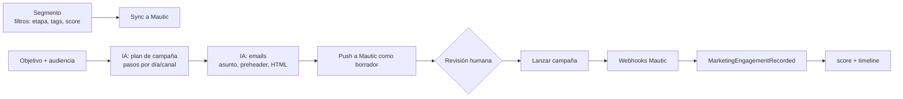
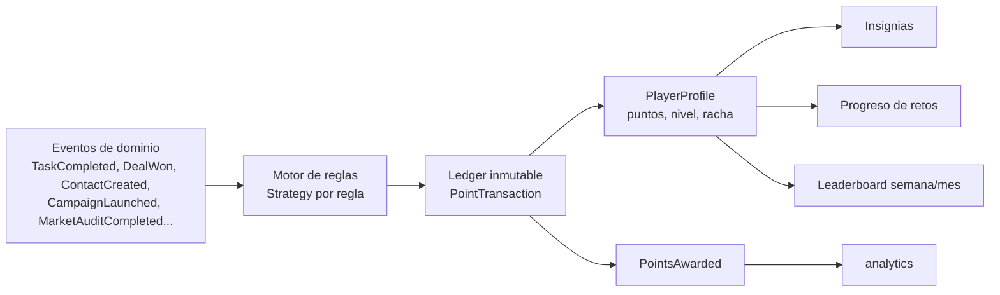

# Pipelines

Dos tipos de pipeline: el de **entrega de software** (CI/CD) y los **pipelines de negocio** que la
plataforma ejecuta. Ambos están diseñados como etapas con entradas/salidas explícitas.

## 1. Pipeline CI/CD

| Etapa | Herramienta | Falla si |
|---|---|---|
| Lint | ruff, eslint | cualquier error |
| Formato | ruff format --check | archivo sin formatear |
| Tipos | mypy, tsc | cualquier error |
| Pruebas | pytest-cov, vitest | test rojo o cobertura < 80 % |
| Build | vite, docker buildx | error de build |
| Seguridad | CodeQL (semanal + PR), Dependabot | alerta alta sin triage |

Workflows: [`.github/workflows/ci.yml`](../../.github/workflows/ci.yml), [`codeql.yml`](../../.github/workflows/codeql.yml).

## 2. Lead-to-customer (Meta → CRM → Mautic → Deal → Conversions API)

## 3. Ciclo de vida de la tarea de limpieza (Stays)

| Job (scheduler) | Frecuencia | Acción |
|---|---|---|
| Recordatorio diario | 19:00 (configurable por workspace) | WhatsApp a cada staff con sus tareas de mañana |
| Confirmación de llegada | cada 5 min | botones "Ya llegué / No han salido / Tengo un problema" a tareas que inician |
| Escalamiento | cada 5 min | tarea `pending` sin llegada a `escalation_minutes` (def. 10) → WhatsApp al supervisor |
| Cortes de servicios | 09:00 | aviso 5 días antes y el día del corte al propietario; pausa automatización hasta verificar comprobante |
| Sincronización iCal | periódico | reservas Airbnb/Booking → tareas en el check-out |

Eventos: `CleaningTaskScheduled`, `CleaningArrivalConfirmed`, `CleaningIssueReported`, `CleaningTaskCompleted`, `ReceiptVerified`.

## 4. Growth IA (Genesis → Blueprint → Assets)

Estados: `draft → analyzing → audited → designing → completed | failed`. Eventos: `MarketAuditCompleted`, `FunnelDesigned`.

## 5. Marketing automation con IA

Regla: la IA **propone**; una persona aprueba antes de enviar (human-in-the-loop).

## 6. Gamificación

Idempotencia: una transacción por (`event_id`, `rule_key`).
