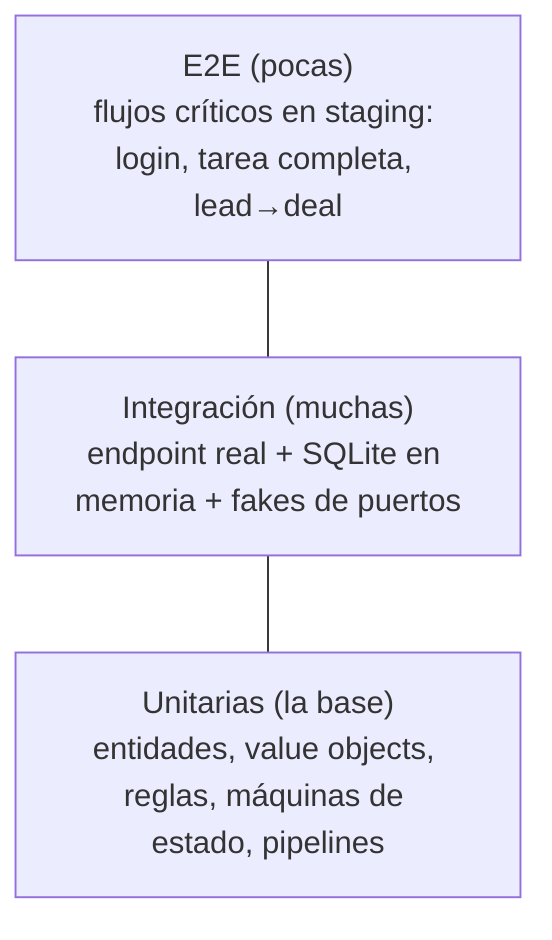

# Estrategia de pruebas

## Pirámide

| Capa | Qué se prueba | Herramienta | Velocidad |
|---|---|---|---|
| Dominio | invariantes, transiciones de estado, eventos registrados | pytest puro | ms |
| Aplicación | caso de uso con UoW real (SQLite) o repos en memoria | pytest-asyncio | ms |
| API | contrato REST, permisos, aislamiento entre tenants, códigos de error | httpx `ASGITransport` | < 100 ms |
| Frontend | hooks de datos, guards de ruta, componentes críticos | vitest + Testing Library | ms |
| E2E | recorridos de negocio | Playwright (staging) | min |

## Fixtures (`apps/api/tests/conftest.py`)
- `settings` → `env=test`, SQLite en memoria, scheduler apagado, rate limit alto.
- `container` → Composition Root con `FakeLLMClient` y `ConsoleMessageSender`.
- `client` → `httpx.AsyncClient` sobre la app real.
- `auth` / `register_workspace()` / `login_as()` → sesión de un workspace nuevo.
- `container.bus.published` → lista de eventos publicados, para afirmar efectos entre módulos.

## Dobles por puerto
| Puerto | Fake | Qué permite verificar |
|---|---|---|
| `LLMClient` | `FakeLLMClient(canned={task: respuesta})` | prompts enviados (`calls`) y respuestas deterministas |
| `MessageSender` | `ConsoleMessageSender.outbox` | destinatario, cuerpo, botones, instancia del workspace |
| `WebSearch` | `NullWebSearch` | pipeline sin red |
| Mautic / Meta Graph / Wompi | adaptadores en memoria de cada módulo | llamadas salientes sin red |
| `FileStorage` | `LocalFileStorage` en `tmp_path` | validación de magic bytes y tamaño |

## Reglas
- Cada caso de uso: camino feliz + al menos un error de regla + permiso denegado.
- Todo endpoint con datos: prueba de **aislamiento entre tenants**.
- Nada de red real ni `sleep` en tests; el tiempo se controla pasando fechas.
- Nombre: `test_<comportamiento_esperado>`; un comportamiento por test.
- Ubicación: `tests/unit/`, `tests/integration/`, `tests/modules/<módulo>/`.

## Cobertura objetivo
| Ámbito | Mínimo |
|---|---|
| Global (CI bloquea) | 80 % |
| `domain/` de cada módulo | 95 % |
| `application/` | 90 % |
| Adaptadores HTTP externos | camino feliz + error con `httpx.MockTransport` |
