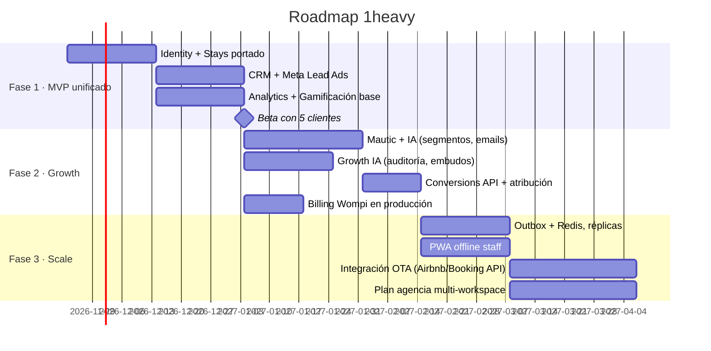

# Análisis de producto — 1heavy

> Versión 2.0 · 2026-11-22 · Integra el análisis de negocio de 1heavy Stays (2026-04) y la visión de MerakiOS.

## 1. Visión
**El sistema operativo de crecimiento y operación para negocios de servicios en LATAM**: captar clientes
con Meta Ads, convertirlos con CRM + Mautic potenciados por IA, operar el servicio con trazabilidad por
WhatsApp y mantener al equipo motivado con gamificación, todo medido en un solo tablero.

Primer vertical: **administradores de alquileres de corta estadía** (donde 1heavy Stays ya tiene producto),
con el motor de growth reutilizable para cualquier negocio de servicios.

## 2. Problema
| Actor | Dolor actual |
|---|---|
| Dueño / administrador | Herramientas dispersas: Meta Ads Manager, hojas de cálculo, WhatsApp personal, un CRM caro en inglés. No sabe qué campaña trae clientes rentables. |
| Marketer | Crea campañas a mano, sin segmentación real ni conexión con ventas; copy lento de producir. |
| Ventas | Leads de Lead Ads que llegan tarde, duplicados o se pierden en un Excel. |
| Gerente de operaciones | Coordina limpiezas por llamadas y chats, sin fotos, sin alertas cuando alguien no llega. |
| Personal de limpieza | No tiene herramienta para confirmar llegada, reportar faltantes ni ver su desempeño. |
| Propietario-inversionista | No ve el estado de su unidad ni los vencimientos de servicios. |

## 3. Segmentos e ICP
- **ICP primario:** empresas de *property management* de 10–150 unidades en Colombia/México/LatAm, que pautan en Meta y operan por WhatsApp.
- **ICP secundario:** negocios de servicios (clínicas estéticas, academias, inmobiliarias, agencias) que usan Meta Ads + WhatsApp y necesitan CRM + automatización (módulos growth/CRM/marketing sin Stays).
- **Canal:** agencias de marketing que revenden 1heavy en marca blanca a sus clientes.

## 4. Propuesta de valor por actor
| Actor | Valor | Módulos |
|---|---|---|
| Dueño | Un tablero con costo por lead, ventas, operación y equipo; marca blanca | analytics, identity, billing |
| Marketer | Segmentos y campañas generadas por IA, ejecutadas en Mautic sin costo por contacto; auditoría de mercado y embudos | marketing, growth, meta |
| Ventas | Leads de Meta en segundos en el CRM, deduplicados, con score y "siguiente mejor acción" | crm, meta |
| Operaciones | Tareas desde iCal, evidencia fotográfica, escalamiento automático, ranking del personal | stays, analytics |
| Staff | WhatsApp con botones, checklist claro, puntos y reconocimiento | stays, gamification |
| Propietario | Portal con recordatorios de corte y carga de comprobantes | stays |

## 5. Modelo de negocio
SaaS B2B por suscripción mensual en COP (cobro con Wompi), prueba de 14 días.

| Plan | Precio/mes (COP) | Para quién | Límites indicativos |
|---|---|---|---|
| **Starter** | $89.000 | operador pequeño | 10 propiedades · 1.000 contactos · 3 usuarios · CRM + Stays |
| **Growth** | $249.000 | operador en crecimiento | 50 propiedades · 10.000 contactos · 10 usuarios · + Mautic IA + Meta + gamificación |
| **Scale** | $590.000 | empresa / agencia | ilimitado razonable · 50 usuarios · marca blanca completa · soporte prioritario |

Ingresos adicionales: implementación asistida (setup de Mautic/Meta), créditos de IA por encima del plan, plan agencia (reventa).
> Los precios son hipótesis a validar con 5 clientes beta (el análisis de Stays sugería $30–80 mil COP/mes sólo para operación; el valor agregado de CRM + marketing justifica el salto, pero debe probarse).

## 6. Competencia
| Competidor | Fortaleza | Debilidad frente a 1heavy |
|---|---|---|
| Guesty / Hostaway | PMS completo, integraciones OTA | caros, en inglés, sin CRM/marketing ni WhatsApp nativo |
| Breezeway / Properly | operación y limpieza | sólo operación, precio en USD |
| HubSpot | CRM + marketing líder | costo por contacto, complejidad, sin operación |
| GoHighLevel | todo-en-uno para agencias | genérico, curva alta, soporte en inglés, sin operación de campo |
| Kommo (amoCRM) | CRM conversacional WhatsApp | sin operación ni analítica de Ads profunda |
| Mautic solo | automatización open source | sin CRM de ventas, sin IA, requiere técnicos |

**Diferenciadores:** WhatsApp como canal operativo nativo · Mautic open source + IA (sin costo por contacto) · Meta Lead Ads → CRM → Conversions API cerrando el ciclo · gamificación basada en resultados reales · español y precios en COP · marca blanca.

## 7. North Star y KPIs
**North Star:** *Ingresos atribuidos gestionados por semana* (valor de negocios ganados cuyo origen es trazable en 1heavy) — en el vertical Stays se complementa con *limpiezas completadas a tiempo con evidencia por semana*.

| Módulo | KPI | Meta inicial |
|---|---|---|
| identity | activación: workspaces que completan onboarding en 24 h | ≥ 60 % |
| stays | % tareas a tiempo · % con fotos completas · incidencias por 100 tareas | ≥ 95 % · ≥ 98 % · ≤ 5 |
| crm | tiempo de primera respuesta a lead · tasa lead→cliente | < 5 min · +20 % vs línea base |
| marketing | tasa de apertura / clic · emails generados por IA aprobados sin edición | ≥ 25 % / 3 % · ≥ 50 % |
| meta | CPL · ROAS · leads sincronizados sin pérdida | ↓ 15 % · ↑ · 100 % |
| growth | proyectos con auditoría + embudo completados | ≥ 1 por workspace/mes |
| gamification | usuarios activos semanales con puntos · participación en retos | ≥ 70 % · ≥ 50 % |
| analytics | workspaces que abren el tablero semanalmente | ≥ 80 % |
| negocio | MRR · churn mensual logo · NRR | — · < 3 % · > 100 % |

## 8. Roadmap

## 9. Riesgos y mitigaciones
| Riesgo | Prob. | Impacto | Mitigación |
|---|---|---|---|
| Bloqueo de números en WhatsApp no oficial (Evolution/Baileys) | media | alto | número propio por workspace (aislado); ruta a WhatsApp Cloud API oficial vía el mismo puerto `MessageSender` |
| Cambios/revisión de la Meta Marketing API | media | medio | adaptador aislado, versión de Graph configurable, App Review planificado |
| Operar Mautic (entregabilidad, cron) | media | medio | Mautic opcional por flag; SMTP gestionado (SES); guía de setup |
| Costos y alucinaciones de IA | media | medio | human-in-the-loop, salidas JSON validadas, límites por plan, proveedor intercambiable |
| Alcance demasiado amplio | alta | alto | lanzar por fases y vertical; medir uso por módulo antes de profundizar |
| Fuga de datos entre tenants | baja | crítico | tenant desde token, pruebas de aislamiento obligatorias, RLS como defensa en profundidad |
| Protección de datos (Ley 1581) | media | alto | consentimiento y origen por contacto, exportar/borrar, hash en CAPI |

## 10. Go-to-market
1. **Beta pagada** con 3–5 property managers que ya usaban Stays: precio Growth con 50 % de descuento a cambio de feedback semanal.
2. **Casos de éxito** medibles (CPL, % a tiempo) → contenido para Meta Ads, ejecutado con el propio 1heavy (*dogfooding*).
3. **Canal agencias**: marca blanca + comisión recurrente.
4. Onboarding asistido de 30 minutos: conectar WhatsApp (QR), Meta y primera campaña generada por IA.
